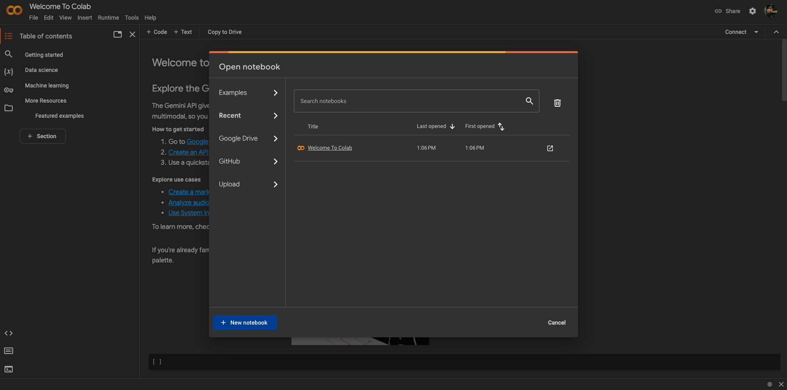
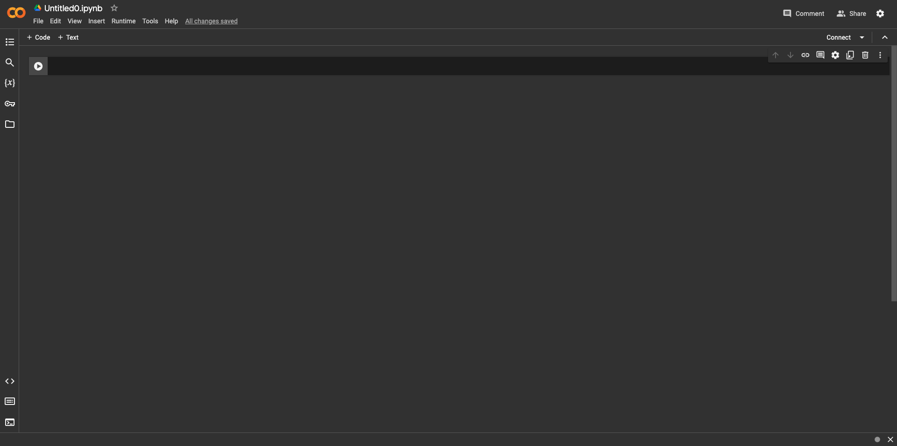
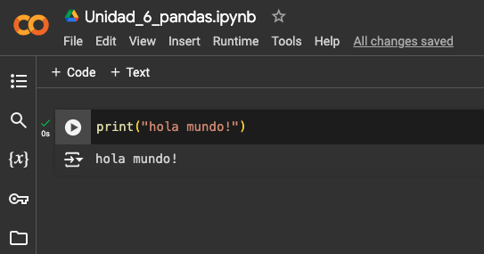
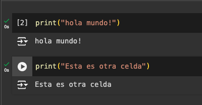
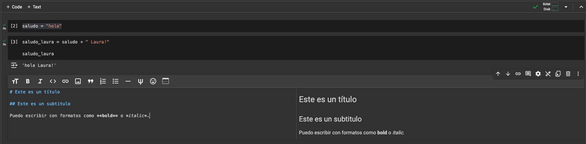

:::{.callout-note}
### Videos Teóricos
Los videos teóricos de esta unidad se encuentran en <a href="https://www.youtube.com/watch?v=94kWDFmxUak&list=PLREanPs7CWghISlGW_nXf-pTbtnBpveow" target="_blank">esta lista de reproducción</a>. Los videos son a modo introductorio: para la correcta aprobación de la materia se deben leer los apuntes.
:::

## Introducción

Como en todas las disciplinas, la Ingeniería de Software y la Programación de Sistemas en general tienen un **lenguaje técnico** específico. La utilización de ciertos términos y el compartir de ciertos conceptos agiliza el diálogo y mejora la comprensión con los pares.

En este capítulo vamos a hacer una breve introducción de ciertos conceptos, ideas y modelos que van a permitirnos establecer acuerdos y manejar un lenguaje común.

### La Computadora
Una computadora es un dispositivo físico de procesamiento de datos, con un propósito general.
Todos los programas que escribiremos serán ejecutados (o *corridos*) en una computadora.
Una computadora es capaz de procesar datos y obtener nueva información o resultados.

### Software y Hardware
Toda computadora funciona con software y hardware. El software es el conjunto de herramientas abstractas (programas), y se le llama **componente lógica** del modelo computacional. El hardware es el **componente físico** del dispositivo.
Básicamente, el software dice qué hacer, y el hardware lo hace.

::: {.callout-tip}
### **¿Es indispensable tener una computadora para crear un algoritmo?** \
La respuesta, sorprendentemente, es no: muchos de los algoritmos que se utilizan de forma computacional hoy en día fueron diseñados varias décadas atrás. Pero la implementación de un algoritmo depende del grado de avance del hardware y la tecnología disponible.
:::

### Sistema Operativo
El sistema operativo es el programa encargado de administrar los recursos del sistema. Los recursos (como la memoria, por ejemplo) son disputados entre diferentes programas o procesos ejecutándose al mismo tiempo. El sistema operativo es el que decide cómo administrar y asignar los recursos disponibles.

Los sistemas operativos más comunes el día de hoy son: Windows, Linux, iOS, Android; por ejemplo.

### Algoritmo
**Un algoritmo es una serie finita de pasos precisos para alcanzar un objetivo.**

- "serie": porque son continuados uno detrás del otro, de forma ordenada.
- "finita": porque no pueden ser pasos infinitos, en algún momento deben terminar.
- "pasos precisos": porque en un algoritmo se debe ser lo más específico posible.

> **Ejemplo**
Un algoritmo puede ser una receta de cocina: tiene una serie finita de pasos (son ordenados, uno detrás de otro, finitos porque en algún momento deben terminar), que son precisos (porque tienen indicaciones de cuánto agregar de cada ingrediente, cómo incorporarlo a la preparación, etc) y están orientados en alcanzar un objetivo (obtener una comida en particular).

#### Creación de un Algoritmo
La forma en la que trabajaremos la creación de un algoritmo es siguiendo los siguientes pasos:

1. Análisis del problema: entender el objetivo y los posibles casos puntuales del mismo.\
2. Primer borrador de solución: confeccionar una idea generalizada de cómo podría resolverse el problema.\
3. División del problema en partes: dividir el problema en partes ayuda a descomponer un problema complejo en varios más sencillos.\
4. Ensamble de las partes para la versión final del algoritmo: acoplar todo el conjunto de partes del problema para lograr el objetivo general.\

Estos cuatro pasos podrán iterarse (repetirse) la cantidad de veces que sean necesarios, para poder lograr acercarnos más a la solución en cada iteración.

### Programa
**Un programa es un algoritmo escrito en un lenguaje de programación.**

### Lenguaje de Programación
Un lenguaje de programación es un **protocolo de comunicación**.\
Un protocolo es un **conjunto de normas consensuadas**.\
$\implies$ Entonces, un lenguaje de programación es un conjunto de normas consensuadas, entre la persona y la máquina, para poder comunicarse.

Cuando logramos que un *lenguaje* pueda ser comprendido por el humano y por la máquina, tenemos una comunicación efectiva en donde podremos hacer programas y pedirle a la máquina que los ejecute.

Un buen ejemplo de cómo una computadora interpreta nuestras instrucciones sin pensar al respecto, sin tener sentido común y sin ambigüedades, es [este video](https://www.youtube.com/watch?v=cDA3_5982h8). La computadora lo único que hace es *interpretar* de forma explícita lo que nosotros le pedimos que haga.

Un lenguaje de programación tiene reglas estrictas que se deben respetar y no se admiten ambiguedades o sobreentendidos.

### Entorno de Desarrollo
Un entorno de desarrollo es un conjunto de herramientas que nos permiten escribir, editar, compilar y ejecutar programas.\

En la materia utilizaremos un entorno de desarrollo llamado Google Colab, que nos permite escribir código en un editor de texto, compilarlo y ejecutarlo en un mismo lugar de forma online. Pero existen muchos otros entornos de desarrollo, como por ejemplo Visual Studio Code, Eclipse, NetBeans, etc.

## Lenguaje Python

En este curso utilizaremos el lenguaje de programación **Python**. Python es un lenguaje de programación de propósito general, que se utiliza en muchos ámbitos de la industria y la academia.

Python es un lenguaje realmente fácil de aprender, con una curva de aprendizaje muy suave. Es un lenguaje de alto nivel, lo que significa que es un lenguaje que se asemeja mucho al lenguaje natural, y que no requiere de conocimientos de bajo nivel para poder utilizarlo.

### Hola, Mundo!
El primer programa que se escribe en cualquier lenguaje de programación es el programa "Hola, Mundo!". Este programa es un programa que imprime en pantalla el texto "Hola, Mundo!".

En Python, el programa "Hola, Mundo!" se escribe de la siguiente forma:

```{python}
print("Hola, Mundo!")
```

`print` es una función que imprime en pantalla el texto que se le pasa entre paréntesis.
En este caso, el texto que se le pasa como parámetro es `"Hola, Mundo!"`.
Al escribir las comillas dobles, estamos indicando que el texto que se encuentra entre ellas es un texto literal.

De la misma forma, podremos imprimir cualquier otro mensaje en pantalla, como por ejemplo:

```{python}
print("Hola, me llamo Rosita y soy programadora")
```

Al igual que Rosita, al hacer nuestro primer 'Hola, Mundo!' nos convertimos en programadores. ¡Felicitaciones!

A partir de la próxima clase, comenzaremos a ver cómo escribir programas más complejos, que nos permitan resolver problemas más interesantes.

## Trabajar con Inteligencia Artificial

### 1. ¿Qué es una IA?

"Inteligencia Artificial" es un nombre amplio para los sistemas que hacen tareas que asociamos con la inteligencia humana: reconocer imágenes, traducir, jugar al ajedrez, recomendar una película o responder una pregunta. En el libro "Inteligencia Artificial: Un Enfoque Moderno" (Russell y Norvig) se define a la IA como el estudio de **agentes** que perciben su entorno y actúan sobre él para alcanzar objetivos.

Dentro de ese paraguas hay capas:

| Término | Qué es | Ejemplo |
| --- | --- | --- |
| Inteligencia Artificial | Cualquier sistema que resuelve tareas "inteligentes", con reglas escritas a mano o aprendidas | Un programa de ajedrez de los 90 |
| Aprendizaje automático (*machine learning*) | Sistemas que **aprenden reglas a partir de datos** en vez de que alguien las programe | Un filtro de spam |
| Aprendizaje profundo (*deep learning*) | Aprendizaje automático con **redes neuronales** de muchas capas | Reconocimiento de caras |
| Modelos de lenguaje grandes (LLM) | Redes neuronales enormes entrenadas con texto para **continuar texto** | ChatGPT, Claude, Gemini |
| Agentes de IA | Un LLM que además puede **usar herramientas**: ejecutar código, buscar en la web, leer y escribir archivos, en varios pasos | Claude Code, Codex, el modo agente de Gemini |

Cuando en la materia digamos "IA" nos vamos a referir casi siempre a los dos últimos: modelos de lenguaje y agentes.

Un LLM es, en el fondo, **un programa**. Recibe una entrada (texto), aplica una función matemática gigante y devuelve una salida (también texto). Todo lo que veremos en las unidades 1 a 3 (entrada, proceso, salida, funciones, algoritmos) también es un programa, pero mucho más simple.

### 2. ¿Cómo funciona y de dónde saca los datos?

#### 2.1 La tarea básica: predecir la próxima palabra

Un modelo de lenguaje se entrena con una sola tarea: **dado un texto, adivinar cuál es el próximo fragmento** (un *token*, que es una palabra o un pedazo de palabra).

Ejemplo: si el texto es `"El cielo es de color"`, el modelo calcula una probabilidad para cada token posible:

| Próximo token | Probabilidad (ilustrativa) |
| --- | --- |
| azul | 0.62 |
| gris | 0.14 |
| celeste | 0.11 |
| negro | 0.04 |
| ... | ... |

Elige uno (no siempre el más probable), lo agrega al texto y repite. Una respuesta larga es este paso repetido cientos de veces. Stephen Wolfram (informático y físico) lo resume así: el modelo está "agregando una palabra por vez" de forma que el texto siga pareciendo razonable.

#### 2.2 Las tres etapas del entrenamiento

1. **Preentrenamiento.** El modelo lee una cantidad enorme de texto: páginas web públicas (por ejemplo, el archivo Common Crawl), libros, artículos científicos, Wikipedia, código de GitHub, y datos licenciados. Ajusta miles de millones de números internos (*parámetros*) para predecir mejor el próximo token. Al terminar, el modelo "sabe" mucho del mundo, pero solo continúa textos: no conversa ni sigue instrucciones.
2. **Ajuste por instrucciones.** Se lo sigue entrenando con ejemplos escritos por personas del tipo "pregunta → buena respuesta", para que aprenda el formato de un asistente.
3. **Aprendizaje por refuerzo con preferencias (RLHF y variantes).** Personas (o, cada vez más, otros modelos) comparan respuestas y marcan cuál es mejor. El modelo se ajusta para producir las respuestas preferidas. De acá salen el tono amable, las negativas a ciertos pedidos y también algunos defectos, como la tendencia a darle la razón al usuario.

#### 2.3 Consecuencias prácticas de cómo aprende

1. **Tiene fecha de corte.** Sabe lo que había en sus datos hasta cierto mes. Lo posterior no lo sabe, salvo que tenga una herramienta de búsqueda.
2. **No "busca" en una base de datos.** Lo aprendido queda comprimido en los parámetros, de forma parecida a como uno recuerda algo leído hace años: la idea general suele estar bien, los detalles exactos (fechas, citas, números) no siempre.
3. **Refleja sus datos.** Si un tema aparece mucho en internet, lo maneja bien. Si aparece poco (por ejemplo, normativa específica de la UBA), inventa con más facilidad. También hereda los sesgos de esos textos.
4. **Las herramientas cambian esto.** Un agente que busca en la web, lee un PDF que le damos o ejecuta código ya no depende solo de su memoria. Por eso **darle el material concreto mejora tanto las respuestas**.

### 3. ¿Son predictivos?

Depende de qué entendamos por "predecir".

**Sí, en un sentido técnico.** Literalmente son máquinas de predicción: predicen el próximo token. Y para hacerlo bien tuvieron que aprender mucha estructura del lenguaje y del mundo. Investigaciones de interpretabilidad de Anthropic (2025) mostraron, por ejemplo, que al escribir un poema con rima el modelo **elige la palabra final del verso antes de escribirlo** y construye la línea para llegar ahí. No es "solo autocompletar palabra por palabra sin plan".

**Pero no predice, en el sentido que solemos usar.** No predicen el mundo ni los hechos:

1. **Predicen texto plausible, no texto verdadero.** Una respuesta puede sonar perfecta y ser falsa. A esto se lo llama "alucinación". Un trabajo de OpenAI (Kalai y otros, 2025) explica que en parte es un efecto de cómo se los entrena y evalúa: los exámenes premian acertar y no dan puntos por decir "no sé", así que **el modelo aprende que adivinar conviene más que no saber**.
2. **No son deterministas.** La misma pregunta puede dar respuestas distintas, porque el modelo *muestrea* entre los tokens probables. Por eso conviene repetir o verificar.
3. **No son buenos pronosticando el futuro.** Para pronosticar (precios, elecciones, demanda) se usan modelos estadísticos o de *machine learning* entrenados con datos del problema. Un LLM puede ayudar a **escribir el código** de ese modelo, pero no *reemplaza* al modelo.
4. **Su confianza no es una medida de certeza.** El tono seguro es parte del estilo aprendido, no una señal de que la respuesta esté bien. Los modelos base tienen cierta calibración interna, pero el ajuste para ser "asistentes" la empeora.

::: {.callout-important}
**Un LLM predice qué texto es probable, no qué es cierto.**
:::

### 4. Cómo comunicarse con ellos, a partir de cómo funcionan

Cada recomendación sale de algo de las secciones 2 y 3. Están basadas en las guías oficiales de Anthropic y OpenAI.

| Porque el modelo... | Entonces conviene... | Ejemplo |
| --- | --- | --- |
| Continúa el texto que recibe y no conoce tu situación | **Dar contexto**: quién sos, para qué es, qué ya sabés | "Soy estudiante de primer año, estoy aprendiendo listas en Python, no vimos diccionarios todavía." |
| Elige la continuación más probable para una pregunta vaga, que es una respuesta genérica | **Ser específico** con la tarea y el formato de salida | "Explicame el error en 3 líneas y no me des el código corregido." |
| Aprende muy bien de patrones | **Dar ejemplos** de entrada y salida esperada | "Para `[1, 2, 3]` debería devolver `6`." |
| Recuerda de forma imprecisa y alucina detalles | **Darle las fuentes** (el enunciado, el archivo, el apunte) en vez de pedirle que las recuerde | Proveer la información completa, no sólo el contexto. |
| Genera token por token, y lo que escribe antes condiciona lo que sigue | **Pedirle que razone paso a paso** o que primero haga un plan | "Antes de escribir código, listá los pasos del algoritmo." |
| Tiende a darte la razón | **No sugerir la respuesta** que querés escuchar; pedir críticas explícitas | "¿Qué está mal en este razonamiento?" en vez de "¿Está bien, no?" |
| No es determinista y puede equivocarse con confianza | **Verificar**: ejecutar el código, probar casos borde, contrastar con el apunte | Correr el programa con una lista vacía. |
| Una conversación larga acumula errores y contexto viejo | **Empezar de nuevo** cuando se desvía, con un pedido mejor | Abrir un chat nuevo con el enunciado y lo aprendido. |
| Con herramientas (agentes) puede actuar, no solo responder | **Dar tareas acotadas y revisar cada paso** | "Agregá una función que valide el DNI y corré los tests." |

#### Usarlo para aprender, no solo para resolver

Los estudios de la sección 5 muestran que importa **cómo** se lo usa. Pedidos que ayudan a aprender:

1. "No me des la respuesta. Haceme preguntas para que llegue yo."
2. "Explicame este concepto y después tomame un ejercicio parecido."
3. "Acá está mi solución. Señalá errores sin corregirlos."
4. "Explicame qué hace este código línea por línea."

Pedidos que ***reemplazan*** el aprendizaje: "Resolveme el ejercicio 4 de la guía."

### 5. Qué dicen los estudios sobre su efecto cognitivo

**La evidencia es reciente, todavía despareja y depende mucho de cómo se use la IA.** El patrón que se repite es que usarla para **reemplazar** el esfuerzo *perjudica* el aprendizaje, y usarla para **acompañar** el esfuerzo puede ayudar.

| Estudio | Qué hicieron | Qué encontraron | Limitaciones del estudio |
| --- | --- | --- | --- |
| Bastani y otros, *PNAS* 2025 | Experimento con ~1000 estudiantes de matemática de secundaria en Turquía. Tres grupos: sin IA, ChatGPT común, y un "GPT Tutor" con instrucciones que no da respuestas | Con ChatGPT común resolvieron 48% mejor durante la práctica, pero en el examen **sin** IA les fue 17% peor que a quienes nunca la tuvieron. El GPT Tutor eliminó casi todo ese efecto negativo | Una sola escuela, una materia, momento en que la herramienta era novedad. |
| Kestin y otros, *Scientific Reports* 2025 | 194 estudiantes de física en Harvard; tutor de IA diseñado con principios pedagógicos vs. clase activa presencial | Ganancias de aprendizaje mayores con el tutor de IA, en menos tiempo | Dos temas, evaluación inmediata, no medido a largo plazo. Los autores dicen que no reemplaza al docente |
| Kosmyna y otros (MIT Media Lab), preprint 2025 | 54 personas escriben ensayos con ChatGPT, con buscador o sin nada, midiendo actividad cerebral con EEG | El grupo con ChatGPT mostró menor conectividad cerebral, menos sensación de autoría y le costó citar su propio ensayo. Los autores hablan de "deuda cognitiva" | Muestra chica, sin revisión por pares, una sola tarea. La prensa exageró sus conclusiones |
| Lee y otros (Microsoft y CMU), CHI 2025 | Encuesta a 319 trabajadores del conocimiento sobre 936 usos reales | Más confianza en la IA se asocia con menos pensamiento crítico; más confianza en uno mismo, con más. El trabajo pasa de producir a verificar e integrar | Autorreporte; no mide habilidad ni causalidad |
| Gerlich, *Societies* 2025 | Encuestas y entrevistas a 666 personas | Correlación negativa entre uso frecuente de IA y pensamiento crítico, explicada en parte por la "descarga cognitiva". Más fuerte en jóvenes | Correlación, no causalidad |
| Anthropic, Informe de Educación 2025 | Análisis de ~575.000 conversaciones académicas de estudiantes universitarios con Claude | Casi la mitad fueron "directas": buscar la respuesta con el mínimo esfuerzo | Datos de una sola empresa; no mide aprendizaje |
| AI Hub for Education (Stanford), revisión 2026 | Revisión de 52 estudios experimentales y cuasiexperimentales | Usar IA como apoyo (explicaciones, práctica) da mejores resultados que usarla para terminar el trabajo. Los estudiantes pueden **creer** que aprenden más aunque no sea así | Reportado por EdWeek; revisar el paper original antes de citar |

#### Conceptos clave

1. **Descarga cognitiva (*cognitive offloading*).** Delegar en una herramienta algo que antes hacía nuestra mente. No es malo en sí (anotar en una agenda también lo es), pero si se delega justo lo que se está aprendiendo, no se aprende.
2. **Ilusión de aprendizaje.** Entender una explicación no es lo mismo que poder hacerlo. La IA hace que todo parezca entendido.
3. **Dificultad deseable.** El esfuerzo de equivocarse y corregir es parte de cómo se aprende. Una herramienta que lo saca todo, saca también el aprendizaje.

### Lecturas recomendadas no obligatorias

1. Stephen Wolfram, *What Is ChatGPT Doing... and Why Does It Work?* (2023). Gratis en <a href="https://writings.stephenwolfram.com/2023/02/what-is-chatgpt-doing-and-why-does-it-work/" target="_blank">writings.stephenwolfram.com</a>. Explicación clara de la predicción de tokens.
2. Ethan Mollick, *Co-Intelligence: Living and Working with AI* (2024). Cómo trabajar con IA, incluida la idea de frontera irregular.
3. Arvind Narayanan y Sayash Kapoor, *AI Snake Oil* (2024). Qué puede y qué no puede hacer la IA, en especial para predecir.
4. Anthropic, <a href="https://docs.claude.com/en/docs/build-with-claude/prompt-engineering/overview" target="_blank">guía de *prompt engineering*</a>.
5. OpenAI, <a href="https://platform.openai.com/docs/guides/prompt-engineering" target="_blank">guía de *prompt engineering*</a>.

### Fuentes

1. Bastani, H. y otros (2025). *Generative AI without guardrails can harm learning: Evidence from high school mathematics.* PNAS 122(26). <https://papers.ssrn.com/abstract=4895486>
2. Kestin, G. y otros (2025). *AI tutoring outperforms in-class active learning.* Scientific Reports 15, 17458. <https://pmc.ncbi.nlm.nih.gov/articles/PMC12179260/>
3. Kosmyna, N. y otros (2025). *Your Brain on ChatGPT.* arXiv:2506.08872. <https://www.media.mit.edu/publications/your-brain-on-chatgpt/>
4. Lee, H.-P. y otros (2025). *The Impact of Generative AI on Critical Thinking.* CHI '25. <https://advait.org/files/lee_2025_ai_critical_thinking_survey.pdf>
5. Gerlich, M. (2025). *AI Tools in Society: Impacts on Cognitive Offloading and the Future of Critical Thinking.* Societies 15(1), 6. <https://doaj.org/article/d5c17dd91ce64775a065095d8af730ce>
6. Dell'Acqua, F. y otros (2023). *Navigating the Jagged Technological Frontier.* HBS Working Paper / SSRN 4573321. <https://mitsloan.mit.edu/sites/default/files/2023-10/SSRN-id4573321.pdf>
7. Becker, J. y otros, METR (2025). *Measuring the Impact of Early-2025 AI on Experienced Open-Source Developer Productivity.* arXiv:2507.09089. <https://metr.org/blog/2025-07-10-early-2025-ai-experienced-os-dev-study/>
8. Kalai, A. T. y otros (2025). *Why Language Models Hallucinate.* arXiv:2509.04664. <https://openai.com/index/why-language-models-hallucinate/>
9. Anthropic (2025). *Tracing the thoughts of a large language model.* <https://www.anthropic.com/research/tracing-thoughts-language-model>
10. Anthropic (2025). *Anthropic Education Report: How University Students Use Claude.* <https://www.anthropic.com/news/anthropic-education-report-how-university-students-use-claude>
11. EdWeek (nov. 2026). *Is AI good or bad for learning? The answer isn't so simple.* <https://www.edweek.org/technology/is-ai-good-or-bad-for-learning-the-answer-isnt-so-simple/2026/11>
12. Sharma, M. y otros (2023). *Towards Understanding Sycophancy in Language Models.* arXiv:2310.13548
13. Kadavath, S. y otros (2022). *Language Models (Mostly) Know What They Know.* arXiv:2207.05221
14. Ouyang, L. y otros (2022). *Training language models to follow instructions with human feedback.* arXiv:2203.02155
15. UNESCO (2024). *AI competency framework for students.* <https://raise.mit.edu/wp-content/uploads/2025/04/391105eng.pdf>

## Anexo: Google Colab

### Cómo usar Google Colab

Para usar Google Colab, debemos ingresar a <a href="https://colab.research.google.com/" target="_blank">este link</a>. Si es necesario, debemos crear una cuenta de Google.

Al abrir Google Colab por primera vez, vamos a ver lo siguiente:



Vamos entonces a hacer click en "New Notebook", y se va a abrir un archivo nuevo, con extensión `.ipynb` (que es la extensión de un archivo del tipo IPython Notebook). Vamos a cambiarle el nombre de 'Untitled0' a 'Unidad_1' o el nombre que prefieran.



#### Celdas de Código

Con Colab vamos a poder correr nuestro código. Colab se divide en celdas individuales: cada celda es un bloque de código que se puede correr por separado. Para agregar una celda nueva, se hace click en el botón de "+ Code" que aparece en la parte superior izquierda de la celda.
Para correr la celda, se hace click en el botón de "play" que aparece a la izquierda de la celda. El output (la salida) de la celda va a aparecer debajo de la misma.

::: {.callout-tip}
### Cómo usar las celdas
Les recomendamos que cada ejercicio de la guía esté en una celda separada.
A medida que avance la materia vamos a terminar de entender bien por qué.
:::



Si tenemos varias celdas con código, podemos correrlas todas juntas haciendo click en "Runtime" o "Entorno de Ejecución" en el menú superior y luego en "Run all" (o "Ejecutar Todo"). Cada celda de código va a tener su propio output debajo de ella. 



#### Celdas de Texto

Así también como podemos agregar celdas de código, podemos agregar celdas de texto. Para eso, hacemos click en el botón de "+ Text" que aparece en la parte superior izquierda de la celda. Dentro podemos escribir texto con formato e incluso agregar imágenes. 



#### Opciones de Celdas
Para reordenar, eliminar o copiar celdas, al seleccionar una celda aparece un menú a la derecha con distintos íconos. Podemos usar estas opciones para realizar estas distintas acciones.


#### Aclaración IA

- Para desactivar las sugerencias con IA (recomendado hacerlo) pueden ir a: Herramientas > Configuración > Asistente IA > Tildar "Ocultar funciones de IA generativa".

#### Beneficios de usar Google Colab

- Google Colab tiene una mejor interfaz para usar Pandas, mostrando el output en forma de tablas.
- Permite importar datos de Google Drive
- Permite compartir el código con otras personas, de tal forma que todas ellas puedan editar un mismo archivo
- Permite guardar los archivos en Google Drive, con guardado automático de cambios
- Permite exportar el archivo en distintos formatos, como PDF, HTML, etc.
- Permite intercalar código ejecutable con texto explicativo, lo que lo hace ideal para la creación de informes, presentaciones, o tutoriales.